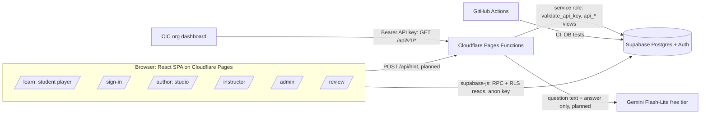

# DJKKU - Coding in Color

Built at [ASU Fall Hackathon 2026 | Phoenix Hackathon for Nonprofits: Nov 14-15](https://www.ohack.dev/hack/fall-2026) for the public good (MIT license).

> **This is your team's ONE repository. All code goes here.** Please don't create
> another repo (personal or org). Judges, the Team Dashboard's code-activity card,
> the public project page and the nonprofit all read **this** repo; work pushed
> anywhere else is invisible to them and won't count. Everyone on the team should be
> a collaborator here. Ask an organizer in Slack if someone can't push.

| | |
|---|---|
| **Nonprofit** | [Coding in Color](https://www.ohack.dev/nonprofit/YIXYdYCoxIZC08uQ5DL3) |
| **Problem statement** | [Curriculum & Student Progress Platform (CIC Problem 1)](https://www.ohack.dev/project/d09466fadf1b11f18e63deadc507a848) |
| **Team page** | [DJKKU](https://www.ohack.dev/hack/fall-2026/team/8069901ee05711f1b598deadb145c312) · [Team Dashboard](https://www.ohack.dev/hack/fall-2026/manageteam) (story, demo video, submit) |
| **Slack** | team: [#djkku](https://opportunity-hack.slack.com/app_redirect?channel=djkku) · nonprofit: [#npo-coding-in-color](https://opportunity-hack.slack.com/app_redirect?channel=npo-coding-in-color) · help: [#ask-a-mentor](https://opportunity-hack.slack.com/archives/C01E5CGDQ74) |
| **Created by** | Umang Rajnikant Bid |

## Final day

Start recording your demo video by **Sun Nov 15, 12:00 PM MST**. Hacking ends at **Sun Nov 15, 2:00 PM MST**, and a demo you recorded with time to spare beats a feature you finished at 1:59.

- Sun Nov 15, 11:00 AM MST: Presentation Feedback Hour
- **Sun Nov 15, 12:00 PM MST: Start recording your demo video**
- Sun Nov 15, 12:30 PM MST: Judges Arrive
- **Sun Nov 15, 2:00 PM MST: Submission Deadline, hacking ends**
- Sun Nov 15, 2:05 PM MST: Judging Round 1
- Sun Nov 15, 3:40 PM MST: Judging Final Round
- Sun Nov 15, 4:30 PM MST: Closing Ceremony, winners announced

## Before hacking ends: the submission checklist

Everything is submitted from your [Team Dashboard](https://www.ohack.dev/hack/fall-2026/manageteam); judges read the dashboard, this README and your demo video.

- [ ] **Code pushed** to this repo, in small PRs (see `AGENTS.md`). Judges and future recruiters read the history
- [ ] **Project story** written on the dashboard (`#project`): the problem, who it helps, what you built, what's next
- [ ] **Demo video** (4 minutes or less) on YouTube, Vimeo, Loom or Google Drive, linked on the dashboard (`#demo`). Show it working, not slides
- [ ] **Submit** on the dashboard (you can keep editing until the close)
- [x] This README filled in below: team, tech stack, how to run it, live link if you have one
- Optional: a [DevPost entry](https://opportunity-hack-2026-arizona.devpost.com/). The dashboard is the submission of record.

Judges score **Scope, Documentation, Polish and Security**, plus a separate **Accessibility** prize. The rubric is at [ohack.dev/hackathon-judging-criteria](https://www.ohack.dev/hackathon-judging-criteria). Document your work as GitHub Issues as you go: that's how you get public credit for it.

## What we built

A self-paced learning platform for Coding in Color's high school coding classes. Students work through
modules (video, reading, check, worksheet, exit question) where each step unlocks only after the one
before it, and instructors see who is stuck, who has not started and how much each student learned
(post-test minus pre-test), without a spreadsheet. CIC staff write the lessons, tests and hints in the
browser, and CIC's own dashboard can pull class numbers through a keyed read API.

**Live demo:** TODO: paste the Cloudflare Pages address here once deployed (for example `https://cic-demo.pages.dev`).
Setup steps for whoever deploys it are in [docs/deploy.md](docs/deploy.md).

## Team

| Person | Lane | Owns |
|---|---|---|
| Koen | A: data and security | `supabase/` (schema, row-level security, tests). GitHub handle: TODO |
| Daxx ([daxxcorneiro](https://github.com/daxxcorneiro)) | B: student experience | `src/features/player/` |
| Umang ([UmangBid](https://github.com/UmangBid)) | C: authoring and assessments | `src/features/authoring/`, learning-gain logic, and the lane A rebuild, sign-in, instructor class setup, admin console tabs and reviewer view |
| Jad ([Jad-Alzoubi](https://github.com/Jad-Alzoubi)) | D: instructor and admin | `src/features/instructor/`, `src/features/admin/` |
| Krishna ([krshnknsr21](https://github.com/krshnknsr21)) | E: API, AI, glue | `functions/`, CI, deploy, docs, the read API |

Lane ownership and what each lane owns are in [AGENTS.md](AGENTS.md).

## Try it

The demo holds fake data only. Replace the address with the live URL, or use `npm run dev` after the
local setup below.

| You are | Do this |
|---|---|
| **A student with a code** | Go to `/sign-in` and type `DEMO-0000-0000-0001`. You land on "Start: Variables and Loops pre-test". Each code works once. |
| **A student with a class link** | Open `/join/DEMO-JOIN-1234`, pick an unclaimed name. |
| **A guest** | Open `/learn/explore` to try the free lessons with no account. |
| **An instructor, CIC admin or reviewer** | Sign in with Google at `/sign-in`. A CIC admin has to invite your email first and add instructors to a class (steps in [docs/deploy.md](docs/deploy.md), Part 3). |

## Features

**Built**

| Feature | What it does | Where it lives |
|---|---|---|
| Sign-in | Student login code, class join link, Google for staff, role-aware navigation | `src/features/auth/`, `src/lib/session.ts` |
| Student player | Start-here card, module path, video, reading, checks with hints, worksheets, exit tickets, pre and post tests, own progress and growth, guest mode, self-register | `src/features/player/` |
| Unlock engine and grading | Strict order, pre-test first, post-test last, one-shot tests, answers graded in SQL | `supabase/migrations/` |
| Authoring studio | Lessons and activities, all five question types with hints and explanations, concept tags, pre-test and post-test with pair keys, live preview, save, submit | `src/features/authoring/`, `shared/authoring/` |
| Instructor setup | Create a class, class link with QR code, roster CSV import, printable login sheet, assign modules, class dashboard | `src/features/instructor/` |
| Admin console | Publish queue, staff and roles, classes and instructors, schools, read API keys, mentor assignment, organization overview | `src/features/admin/` |
| Reviewer view | Read-only walkthrough of published modules, no answer keys, no student data | `src/features/reviewer/` |
| Learning gain and analytics | Post minus pre, normalized gain, stuck and not-started lists, concept mastery and "reteach tomorrow", all as SQL views | `shared/authoring/gain.ts`, `supabase/migrations/` |
| Read API for CIC | `GET /api/v1/completion` and `/api/v1/learning-gain`, key and scope checked, groups under 5 hidden, JSON or CSV | `functions/api/v1/`, `shared/api/`, docs at `/api/docs` |
| Database | 26 tables, row-level security everywhere, 46 per-role tests on a real Postgres | `supabase/` |

**Not yet**

- AI hints (the Gemini function). Instructor-written hints work; the "Get a hint" button is off.
- Mentor view (assigning mentors works; mentors have no screen yet).
- Instructor reset of a login code or a test from the dashboard, and the per-student learning-gain table with CSV export.
- Student PIN, `slides` and in-browser Python activity kinds, and unlocking ahead for one student.
- Keepalive and nightly backup jobs, Lighthouse in CI.

The honest, detailed status of every workflow is in [docs/design/system-design-v3.md](docs/design/system-design-v3.md)
(a snapshot from Saturday afternoon, so some "missing" items there have landed since; `docs/progress.md` is the log).

## Architecture

The browser is a React single-page app on Cloudflare Pages. It talks to Supabase (Postgres and Auth)
directly: it reads tables through row-level security and writes only through database functions that
check who is calling. A few Cloudflare Pages Functions sit beside it for the read API (and, later, AI
hints); they use the service-role key, which never reaches the browser. The longer version is in
[docs/architecture.md](docs/architecture.md) and the reasons for each choice are in [docs/decisions.md](docs/decisions.md).



Security is described in [SECURITY.md](SECURITY.md).

## Tech stack

- Frontend: React 19, TypeScript, Vite, Tailwind CSS, shadcn/ui, TanStack Query, react-hook-form, zod
- Backend: Cloudflare Pages Functions (read API, AI hints planned)
- Database: Supabase (Postgres, Auth, row-level security)
- APIs / services: Cloudflare Pages (hosting), GitHub Actions (CI), Gemini free tier (hints, planned)

## Run it locally

You need Node 22.12 or newer (see `.nvmrc`) and, for the database, Docker.

```bash
git clone https://github.com/2026-Arizona-Opportunity-Hack/DJKKU-CodinginColor.git
cd DJKKU-CodinginColor
npm ci
cp .env.example .env     # then fill in your own values; never commit .env
npm run dev              # http://localhost:5173
```

With no Supabase URL in `.env` the app runs in **demo mode** on sample data. For the real thing:

```bash
npx supabase start -x studio,imgproxy,edge-runtime,logflare,vector,mailpit,realtime,storage-api,supavisor,postgres-meta
npx supabase db reset    # applies the migrations and the demo seed from scratch
# copy the printed API URL and anon key into .env as VITE_SUPABASE_URL and VITE_SUPABASE_ANON_KEY,
# and set VITE_DATA_SOURCE=supabase
npm run dev
```

Checks (CI runs the same):

```bash
npm run lint
npm run typecheck
npm test                                  # all unit tests; the database tests run too if Supabase is up
REQUIRE_DB=1 npx vitest run supabase      # the database tests only; fails if no database is reachable
npm run build
```

The `/api/*` Functions are not served by `npm run dev`. To try them, run `npm run build` then
`npx wrangler pages dev dist` (set `SUPABASE_URL` and `SUPABASE_SERVICE_ROLE_KEY` with `--binding`).
More on the database is in [supabase/README.md](supabase/README.md); contributing, lane ownership and how to
add a feature or endpoint are in the "Stack, commands and layout" section of [AGENTS.md](AGENTS.md).

## Deploy and cost

Step-by-step for Supabase and Cloudflare Pages: [docs/deploy.md](docs/deploy.md). It costs **$0 a month** and
needs no credit card: Supabase free plan, Cloudflare Pages free, GitHub Actions free. The first paid
step, if CIC outgrows the free tiers, is Supabase Pro at about $25 a month, which also removes the
7-day idle pause on the free plan.

## Environment variables

`.env.example` and `functions/_lib/env.ts` list the same names. Real values live only in `.env` (ignored by git),
the Cloudflare Pages dashboard, or your shell.

| Name | Set where | What it does |
|---|---|---|
| `VITE_SUPABASE_URL` | Vite build (public) | Supabase project URL. Unset means demo mode. |
| `VITE_SUPABASE_ANON_KEY` | Vite build (public) | Supabase anon (or publishable) key. Safe in the browser: row-level security decides access. |
| `VITE_DATA_SOURCE` | Vite build (public) | `mock` for sample data or `supabase` for the real database. Defaults to `supabase` when the URL is set. |
| `VITE_FEATURE_HINTS` | Vite build (public) | `true` shows "Get a hint" after a wrong answer. Keep `false` until the hint function exists. |
| `VITE_API_BASE` | Vite build (public) | Base URL for `/api/...` calls. Empty means the same site. |
| `SUPABASE_URL` | Pages Function secret | Supabase project URL, for the read API. |
| `SUPABASE_SERVICE_ROLE_KEY` | Pages Function secret | Bypasses row-level security. Server only; never in the browser or git. |
| `GEMINI_API_KEY` | Pages Function secret | Free-tier Gemini key for hints. Optional; planned. |
| `NODE_VERSION` | Cloudflare Pages build setting | Set to `22.12.0` so the build has a new enough Node. |
| `SUPABASE_DB_URL` | Shell or CI (tests only) | Overrides where the database tests connect. Defaults to the local Supabase. |
| `REQUIRE_DB` | Shell or CI (tests only) | `1` makes the database tests fail when no database is reachable, instead of skipping. |
| `SUPABASE_AUTH_EXTERNAL_GOOGLE_CLIENT_ID`, `SUPABASE_AUTH_EXTERNAL_GOOGLE_SECRET` | Shell (local Supabase only) | Only to try Google sign-in locally. The hosted project sets Google in the Supabase dashboard. |

## Links

- Live demo: TODO (see above)
- API reference: `/api/docs` on the deployed site (source: [docs/openapi.yaml](docs/openapi.yaml))
- Demo video: TODO: add the link after recording
- Design and docs: [docs/](docs/), start with [docs/architecture.md](docs/architecture.md); decisions in [docs/adr/](docs/adr/README.md)
- Security: [SECURITY.md](SECURITY.md)

## After the hackathon

Winning teams finish the project with the nonprofit. The [Definition of Done](https://www.ohack.dev/about/completion) (deployed, nonprofit sign-off, docs, open source) is tracked on your team page. Keep the repo public and the README honest; recruiters do read these.

Need a hand this weekend? [#ask-a-mentor](https://opportunity-hack.slack.com/archives/C01E5CGDQ74) on Slack, or ask in [#djkku](https://opportunity-hack.slack.com/app_redirect?channel=djkku) and a mentor will drop in.
