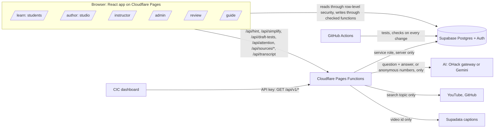

# Coding in Color Learn

**A free, self-paced learning platform for Coding in Color's high school coding classes.** Write a lesson
once, teach it in any partner school, see who needs help while there is still time, and prove with
numbers how much students learned.

| | |
|---|---|
| **Live site** | **<https://cic-demo-6br.pages.dev>** |
| **Demo video** | **[Watch the demo on YouTube](https://youtu.be/WXLUgQNsT7A)** (4 minutes) |
| **Complete guide (PDF)** | **[docs/handbook/CIC-Learn-Complete-Guide.pdf](docs/handbook/CIC-Learn-Complete-Guide.pdf)**: the story, a step-by-step manual for every role, status, roadmap and handover |
| **Nonprofit** | [Coding in Color](https://www.ohack.dev/nonprofit/YIXYdYCoxIZC08uQ5DL3) |
| **Problem statement** | [Curriculum & Student Progress Platform (CIC Problem 1)](https://www.ohack.dev/project/d09466fadf1b11f18e63deadc507a848) |
| **Built at** | [ASU Fall Hackathon 2026, Phoenix Hackathon for Nonprofits](https://www.ohack.dev/hack/fall-2026), Nov 14 to 15, 2026, by team [DJKKU](https://www.ohack.dev/hack/fall-2026/team/8069901ee05711f1b598deadb145c312) |
| **License** | MIT (open source) |
| **Cost to run** | **$0 a month**, no credit card (free tiers of Supabase, Cloudflare Pages and GitHub Actions) |

## Contents

1. [In one minute](#in-one-minute)
2. [Scope: the problem and what we built](#scope-the-problem-and-what-we-built)
3. [Every feature, by role](#every-feature-by-role)
4. [Polish: how ready it is](#polish-how-ready-it-is)
5. [Security and privacy](#security-and-privacy)
6. [Accessibility](#accessibility)
7. [Documentation map](#documentation-map)
8. [Try it in two minutes](#try-it-in-two-minutes)
9. [Deploy it on your own infrastructure](#deploy-it-on-your-own-infrastructure)
10. [Run it on your laptop](#run-it-on-your-laptop)
11. [Configuration reference](#configuration-reference)
12. [How it is built](#how-it-is-built)
13. [What is not done yet, and the next version](#what-is-not-done-yet-and-the-next-version)
14. [Handover checklist for Coding in Color](#handover-checklist-for-coding-in-color)
15. [Team and contributing](#team-and-contributing)

## In one minute

- **Students** sign in with a code from their teacher (no email, no password), take a pre-test, work
  through lessons that unlock one step at a time (video with transcript, reading, practice questions with
  hints, real Python in the browser), take notes, and see how much they grew.
- **Instructors** set up a class in minutes, watch a live view on the projector, see who is stuck and
  exactly which wrong answers to reteach, open any student's full story, and print a one-page impact
  report for funders.
- **CIC staff** write lessons in the browser, pull in YouTube videos and GitHub guides in seconds, let AI
  draft the pre-test and post-test, publish after review, invite staff, and give their own dashboard a
  key to pull results per school.
- **The measure that matters, learning gain,** is calculated on its own: post-test minus pre-test, per
  student, concept, class and school. In the demo data one class went from **29% to 74%** on the same
  questions.

## Scope: the problem and what we built

**The problem.** Coding in Color teaches coding to high school students who are often left out of tech,
in partner schools, camps and after-school programs. Lessons lived in slides, progress lived in
spreadsheets, students missed class and switched devices, and showing funders what students learned
meant counting by hand. CIC asked for one place to:

| CIC needed | What we built | Status |
|---|---|---|
| Write curriculum once, reuse it everywhere, improve it safely | A browser studio with lessons, seven activity types, concepts, preview, review and publishing; published versions are locked so a class is never changed mid-course | Done |
| Students learning at their own pace, on any device, without accounts for minors | Login codes and QR join links, strict unlock rules, catch-up plans, notes, Python in the browser, grade-level explanations, progress and certificates | Done |
| Show instructors who needs help in time to help | Class dashboard, stuck and not-started lists, live class view, what to reteach, a per-student page with next steps | Done |
| Measure learning and report it per school | Paired pre/post tests, learning gain and normalized gain, a printable impact report, and a keyed read API for CIC's dashboard | Done |

**Who it serves.** Every CIC class at every partner school: students (grades roughly 9 to 12, minors),
the instructors who run classes (many are not programmers), CIC's curriculum team and administrators,
outside reviewers, and CIC's funders through the reports. One deployment serves all of CIC's programs at
no cost.

**Why it is not a toy.** The hard parts are real and built: access rules for minors' data enforced in the
database row by row; grading and unlocking that a browser cannot skip; matched pre/post test pairs with a
documented learning-gain definition ([ADR 0020](docs/adr/0020-learning-gain-definition.md)); immutable
module versions; one student keeping their progress across devices; aggregation that hides groups under 5
students; AI that only ever sees the question and the answer.

## Every feature, by role

The in-app **Guide** (`/guide`) lists all of these for each role and links straight to the screen. The
[complete guide (PDF)](docs/handbook/CIC-Learn-Complete-Guide.pdf), Part 2, has numbered steps for each.

### Students

| Feature | What it does |
|---|---|
| Sign in with a code | Type the personal code from the teacher. No email, no password. The same code works on another device and progress moves with the student. |
| Join from a class link or QR code | Open the link, pick your name from the unclaimed names. |
| Try a free lesson | Open lessons for anyone, no account; progress kept on the device and copied over on registering. |
| Start here | The next step, and a catch-up plan (with minutes) after a missed class. |
| Your path | Every lesson in order, and why a locked one is locked. Pre-test first, post-test last. |
| Activities | Video (privacy-enhanced YouTube, with the real transcript), reading, check, worksheet, exit ticket, Python code activity, Parsons problem. |
| Get a hint | After a wrong answer, a hint that points the way without giving the answer (the teacher's written hints, or AI). |
| Explain it for my grade | Any reading or video rewritten in words and examples for grades 1 to 12. |
| Notes and My notebook | A notes panel beside the lesson; only the student sees it; printable notebook for review. |
| My progress and certificates | Finished work, pre-test and post-test scores, growth, and a printable certificate per module. |

### Instructors

| Feature | What it does |
|---|---|
| Create a class | Name it and pick its school. |
| Roster and login sheet | Paste first names and last initials; print a sheet of personal codes. |
| Class link and QR code | Students pick their own name; make a new link to stop the old one. |
| Assign modules | Which published modules, in what order, and when each opens. |
| Late joiners | Start a student at a later module. |
| Class dashboard | Average progress, students list, who is stuck (and why), who has not started, concept mastery, learning gain. |
| Live class view | A projector-friendly grid of every student and activity, refreshed every 20 seconds. |
| What to reteach | The questions most students got wrong first, with the wrong answers they chose. |
| One student in depth | Status, every activity, each pre-test question beside its post-test twin, mastery against the class, the mistake they repeat, activity calendar, suggested next steps; reset login code, allow a retake, CSV, print, and a drafted note home the teacher sends. |
| Impact report | A one-page printable learning-gain report for funders. |

### Authors (CIC staff, and instructors given authoring)

| Feature | What it does |
|---|---|
| Module studio | Lessons and activities, five question types with explanations and up to three written hints, concept tags, Python and Parsons activities, a "Coder spotlight" story template. |
| Find material | Search YouTube, freeCodeCamp, Harvard CS50 and GitHub by topic and language; add a video (embedded, never copied) or an openly licensed README (copied with source and license). |
| AI-drafted tests | One click drafts a paired pre-test and post-test from the module; the author checks and edits every question. |
| Preview as student | Any activity exactly as a student sees it, with no answers. |
| Submit for review, versions | Submit a saved draft; change a published module by making a new version. |

### CIC admins

| Feature | What it does |
|---|---|
| Publish queue | Read, publish or send back submitted modules; publishing is refused with a clear list of what to fix. |
| Overview | Partner schools, classes and staff counts; every class with its school, term and instructors (flags a class with no instructor); class staffing. |
| Staff | Invite by Google email (the role applies on first sign-in), change roles and authoring, remove access (keeps the account and history), cancel unused invites. |
| API keys | Make a key for CIC's dashboard (shown once), see when each was last used, revoke. |
| Everything else | Admins can also use every instructor, author and reviewer screen. |

### Reviewers and CIC's own systems

| Feature | What it does |
|---|---|
| Reviewer view | Every published module as students see it, each pre-test question beside its post-test twin. Read-only; no student data, no answer keys. |
| Read API | `GET /api/v1/completion` and `/api/v1/learning-gain`, per class labelled by school and term, JSON or CSV, key and scope checked, groups under 5 hidden. Documented at `/api/docs`. |

## Polish: how ready it is

- **Deployed and public** at <https://cic-demo-6br.pages.dev>, on free infrastructure, with a tested
  [deployment guide](docs/deploy.md).
- **About 800 automated tests run on every change** (`npm test`): screens with keyboard and screen-reader
  checks, the server functions, and **71 database tests** that exercise every role against the access
  rules and every flow (unlocking, grading, code claims, retakes, staff invites) on a real Postgres.
- **CI blocks a merge unless everything passes**: lint, type checks, all tests, the production build, a
  secret scan (gitleaks), a Playwright browser smoke test, and Lighthouse accessibility at 95 or higher
  ([.github/workflows/](.github/workflows/)).
- **Every screen handles the awkward cases**: loading, empty states ("No students on the roster yet"),
  errors with **Try again**, and plain messages from the database ("That login code is not valid. Ask your
  instructor for a new one."). Destructive actions ask first.
- **Works where CIC works**: Chromebooks, phones, slow connections; transcripts for schools that block
  YouTube; outside services are optional and the app degrades gracefully without them (no AI key means
  written hints, no YouTube key means GitHub-only search).
- **Work left to a solid v1 is small** and listed honestly [below](#what-is-not-done-yet-and-the-next-version).

## Security and privacy

Full model: [SECURITY.md](SECURITY.md), audit: [docs/security-audit.md](docs/security-audit.md),
checklist: [docs/audits.md](docs/audits.md).

- **Minimal data for minors.** A student is a first name and last initial, a class and a school. No email,
  password, birth date or photo. Students sign in with a code, not an account.
- **The database is the gate.** Supabase row-level security on every table: instructors see only their
  classes, reviewers see no student data, answer keys are in tables no client role can read, and writes
  go only through database functions that check the caller. The browser cannot grade, unlock or read a key.
- **Staff by invitation only**, through Google sign-in matched to the invited email; admins can remove
  access instantly.
- **AI sees as little as possible**: a hint sends only the question and the student's answer; attention
  insights send anonymous numbers; any AI failure falls back to non-AI content. On the OHack gateway we
  chose `gpt-oss-120b` because `muse-spark` prompts may be used for training ([decision 25](docs/decisions.md)).
- **Reporting protects small groups**: the read API hides groups under 5 and never names a student; keys
  are stored as hashes and can be revoked.
- **No secrets in git.** Server keys live in Cloudflare's settings; `.env` files are gitignored; gitleaks
  in CI and a pre-commit guard block secrets. Only public values (`VITE_*`) reach the browser.
- **People send messages, not the system**: the note home is drafted and copied, then sent by the teacher.

## Accessibility

- Every screen works by keyboard alone, with visible focus, one `<h1>`, headings in order, labelled
  inputs, live status messages, and focus moved to new content (for example a new API key or a confirmation).
- 44-pixel touch targets, enough colour contrast, and no information conveyed by colour alone.
- Automated: axe checks in the component tests, and Lighthouse accessibility **95 or higher** enforced in
  CI on the main pages.

## Documentation map

| Read this | For |
|---|---|
| [Complete guide (PDF)](docs/handbook/CIC-Learn-Complete-Guide.pdf) | Everyone: the story, a step-by-step manual per role, status, roadmap, handover |
| In-app Guide (`/guide`) | Every feature by role, linked to the screen |
| [docs/deploy.md](docs/deploy.md) | Deploying from scratch, step by step |
| [docs/architecture.md](docs/architecture.md) | How the system fits together, security boundaries, repo layout |
| [docs/decisions.md](docs/decisions.md) and [docs/adr/](docs/adr/README.md) | Every technical decision and why |
| [docs/contracts/database-api.md](docs/contracts/database-api.md) | Every database function and view, who may call it |
| [docs/requirements.md](docs/requirements.md), [docs/tradeoffs.md](docs/tradeoffs.md) | What CIC asked for, and what each choice costs |
| [SECURITY.md](SECURITY.md), [docs/security-audit.md](docs/security-audit.md) | Security model and audit |
| [docs/openapi.yaml](docs/openapi.yaml), `/api/docs` | The read API |
| [supabase/README.md](supabase/README.md) | The database: migrations, seed, tests |
| [AGENTS.md](AGENTS.md) | Repo layout, lanes, commands, how to add a feature or an endpoint |
| [docs/progress.md](docs/progress.md) | The build log, entry by entry |

## Try it in two minutes

The live site holds **fake demo data only**.

| You are | Do this |
|---|---|
| A visitor | Open <https://cic-demo-6br.pages.dev/learn/explore> and try a free lesson. |
| A student | Ask an instructor for a login code (or use a demo class's join link) and sign in at `/sign-in`. |
| Staff | Sign in with Google at `/sign-in`. A CIC admin must invite your email first (Admin → Overview → Invite staff). |
| Anyone | Open `/guide` to see every feature for every role. |

With no database configured (`npm run dev` and no `.env`), the app runs in **demo mode** with sample data.

## Deploy it on your own infrastructure

Everything below is free and needs no credit card. Allow about 45 minutes the first time. The full guide
with screenshots-level detail is [docs/deploy.md](docs/deploy.md); this is the checklist.

**You need:** a GitHub account (fork or clone this repo), a [Supabase](https://supabase.com) account, a
[Cloudflare](https://dash.cloudflare.com) account, a Google account for Google Cloud (staff sign-in), and
on your computer Node **22.12 or newer** (see `.nvmrc`), Git, and the Supabase CLI (`npx supabase`).

### 1. Create the database (Supabase)

1. In Supabase, create a project (pick the closest region, save the database password in a password manager).
2. From **Project Settings → API Keys** note the project URL, the **anon/publishable** key and, under
   **Legacy API keys**, the **service_role** key (server only).
3. Push the schema from your clone:
   ```bash
   git clone https://github.com/2026-Arizona-Opportunity-Hack/DJKKU-CodinginColor.git
   cd DJKKU-CodinginColor && npm ci
   npx supabase login
   npx supabase link --project-ref YOUR_PROJECT_REF
   npx supabase db push --remote          # applies every migration in supabase/migrations
   ```
   Do **not** load `supabase/seed.sql` into a real deployment: it contains demo students with published codes.
4. **Authentication → Sign In / Providers**: turn **Anonymous sign-ins on** (students), **email sign-up off**,
   and raise the anonymous sign-in rate limit (deploy guide, Part 1 steps 3 and 5).

### 2. Staff sign-in (Google Cloud)

1. In [Google Cloud](https://console.cloud.google.com), create a project, configure the OAuth consent
   screen, and create an **OAuth client** (Web). Authorized redirect URI: `https://YOUR_PROJECT_REF.supabase.co/auth/v1/callback`.
2. In Supabase **Authentication → Providers → Google**, paste the client ID and secret and enable it.
3. Publish the consent screen (or add each staff email as a test user), otherwise staff see "access blocked".

### 3. The website and server functions (Cloudflare Pages)

**Option A, connected to GitHub (recommended).** Workers & Pages → Create → **Pages** → Connect to Git →
your repo. Build command `npm run build`, output `dist`, and these **build variables**:

| Variable | Value |
|---|---|
| `NODE_VERSION` | `22.12.0` |
| `VITE_SUPABASE_URL` | your Supabase URL |
| `VITE_SUPABASE_ANON_KEY` | your anon/publishable key |
| `VITE_DATA_SOURCE` | `supabase` |
| `VITE_FEATURE_HINTS` | `true` |

**Option B, direct upload** (when the GitHub connection needs an org owner's approval):
```bash
npx wrangler login
npx wrangler pages project create YOUR_PROJECT --production-branch main
VITE_SUPABASE_URL=... VITE_SUPABASE_ANON_KEY=... VITE_DATA_SOURCE=supabase VITE_FEATURE_HINTS=true npm run build
npx wrangler pages deploy dist --project-name YOUR_PROJECT --branch main
```

Then add the **server secrets** (Settings → Variables and Secrets, type Secret, or
`npx wrangler pages secret put NAME --project-name YOUR_PROJECT`) and **deploy again** so they take effect:

| Secret | Required? |
|---|---|
| `SUPABASE_URL`, `SUPABASE_ANON_KEY`, `SUPABASE_SERVICE_ROLE_KEY` | Required (read API, hints, Find material, transcripts) |
| `AI_GATEWAY_URL` + `AI_GATEWAY_KEY` (+ `AI_MODEL`), or `GEMINI_API_KEY` | Optional: AI hints, grade explanations, test drafts, insights |
| `YOUTUBE_API_KEY` | Optional: YouTube in Find material ([how to get one](docs/deploy.md)) |
| `GITHUB_TOKEN` | Optional: more GitHub searches per minute |
| `SUPADATA_API_KEY` | Optional: real video transcripts |

### 4. Connect them and make the first admin

1. In Supabase **Authentication → URL Configuration**: Site URL = your Pages address; add it, `https://*.YOUR_PROJECT.pages.dev`
   and `http://localhost:5173` to Redirect URLs.
2. Sign in once on your site with Google, then make yourself the first admin in the Supabase SQL editor,
   exactly as in [docs/deploy.md](docs/deploy.md), Part 3, "Make yourself the first admin".
3. From now on, invite everyone else in **Admin → Overview → Invite staff**.

### 5. Check it works

```bash
curl https://YOUR_SITE/api/health                 # {"ok":true,...}
curl -i https://YOUR_SITE/api/v1/completion       # 401: the API is configured and asks for a key
```
Then sign in as admin, create a class, import a roster, sign in as a student in a private window with a
printed code, and make a key in **Admin → API keys** and call `/api/v1/completion` with it.

**Updating later:** with Option A, every push to `main` deploys; run `npx supabase db push --remote` when a
change adds files to `supabase/migrations`. With Option B, rebuild and run `wrangler pages deploy` again.

**Troubleshooting** (more in [docs/deploy.md](docs/deploy.md)): "Cannot find native binding" in the build
means Node is older than 22.12; the app shows demo data means `VITE_SUPABASE_URL` was missing at build
time; Google sign-in returns to the wrong page means the Supabase URL configuration; `/api/v1/*` answering
503 means a missing secret or no redeploy after adding it.

## Run it on your laptop

```bash
npm ci
cp .env.example .env            # fill in your own values; never commit .env
npm run dev                     # http://localhost:5173 (demo mode until .env has a Supabase URL)
```
With a local database (needs Docker):
```bash
npx supabase start -x studio,imgproxy,edge-runtime,logflare,vector,mailpit,realtime,storage-api,supavisor,postgres-meta
npx supabase db reset           # all migrations plus the demo seed
# put the printed API URL and anon key in .env as VITE_SUPABASE_URL and VITE_SUPABASE_ANON_KEY,
# set VITE_DATA_SOURCE=supabase, then: npm run dev
```
Checks (CI runs the same): `npm run lint`, `npm run typecheck`, `npm test`, `npm run build`
(`REQUIRE_DB=1 npx vitest run supabase` runs only the database tests and fails if none is reachable).
The `/api/*` functions are not served by `npm run dev`: run `npm run build` then `npx wrangler pages dev dist`,
with the server values in a gitignored `.dev.vars`.

## Configuration reference

`.env.example` and `functions/_lib/env.ts` list the same names. Real values live only in `.env`, `.dev.vars`
(both gitignored) or the Cloudflare dashboard.

| Name | Where | What it does |
|---|---|---|
| `VITE_SUPABASE_URL` | Build (public) | Supabase project URL. Unset means demo mode. |
| `VITE_SUPABASE_ANON_KEY` | Build (public) | Supabase anon/publishable key; safe in the browser, row-level security decides access. |
| `VITE_DATA_SOURCE` | Build (public) | `mock` (sample data) or `supabase`. Defaults to `supabase` when the URL is set. |
| `VITE_FEATURE_HINTS` | Build (public) | `true` shows "Get a hint" after a wrong answer. |
| `VITE_API_BASE` | Build (public) | Base URL for `/api/...`. Empty means the same site. |
| `SUPABASE_URL` | Server secret | Supabase project URL for the functions. |
| `SUPABASE_ANON_KEY` | Server secret | The public anon key, used to check who a caller's token belongs to. |
| `SUPABASE_SERVICE_ROLE_KEY` | Server secret | Bypasses row-level security. Server only; never in the browser or git. |
| `GEMINI_API_KEY` | Server secret | Optional AI provider (free tier). |
| `AI_GATEWAY_URL`, `AI_GATEWAY_KEY`, `AI_MODEL` | Server secret | Optional OpenAI-compatible AI gateway, used instead of Gemini; model defaults to `gpt-oss-120b`. |
| `YOUTUBE_API_KEY` | Server secret | Optional: YouTube in Find material (about 100 searches a day free). |
| `GITHUB_TOKEN` | Server secret | Optional: GitHub token with no permissions, 30 searches a minute instead of 10. |
| `SUPADATA_API_KEY` | Server secret | Optional: real video transcripts (100 a month free, each video fetched once). |
| `NODE_VERSION` | Cloudflare build | `22.12.0`. |
| `SUPABASE_DB_URL`, `REQUIRE_DB` | Shell or CI | Database tests: where to connect; `1` fails instead of skipping without a database. |
| `SUPABASE_AUTH_EXTERNAL_GOOGLE_CLIENT_ID`, `SUPABASE_AUTH_EXTERNAL_GOOGLE_SECRET` | Shell | Only to try Google sign-in on a local Supabase. |

## How it is built

| Part | Technology |
|---|---|
| Website | React 19, TypeScript, Vite, Tailwind CSS, shadcn/ui, TanStack Query, react-hook-form, zod |
| Database and sign-in | Supabase: Postgres, Auth (anonymous sessions plus login codes for students, Google for staff), row-level security; grading, unlocking and claims are Postgres functions |
| Server functions | Cloudflare Pages Functions: read API, AI helpers, Find material, transcripts (`functions/api/`, logic in `shared/`) |
| Python in the browser | Pyodide |
| Outside services (optional) | OHack AI gateway or Google Gemini, YouTube Data API, GitHub API, Supadata |
| Quality | Vitest, Testing Library, axe-core, Playwright, Lighthouse CI, gitleaks, GitHub Actions |



More: [docs/architecture.md](docs/architecture.md) and [docs/decisions.md](docs/decisions.md).

## What is not done yet, and the next version

**Known limits today** (each has a workaround; details in the [complete guide](docs/handbook/CIC-Learn-Complete-Guide.pdf), Part 3):

- The AI helpers run on the hackathon's AI gateway key, which stops after the event (Sun Nov 15, 6 PM
  Arizona time). Set `GEMINI_API_KEY` or another gateway; until then hints are the teacher's written ones.
- **Mentors:** the database supports a mentor role (sees only assigned students), but there are no mentor
  screens yet, so the role is not offered.
- A student's code acts as their password until reset; the class link lets anyone with it pick an
  unclaimed name (show it only in class, make a new one after).
- Python activities cannot read typed `input()`; values go in the code.
- Transcripts with no language label are not double-checked for language.
- No class-wide learning-gain CSV yet (each student's page has one).

**The next version**, in order of value to CIC:

1. **Handover to CIC's own accounts** (below) and a long-term AI key.
2. **Spanish interface** for students and families.
3. **Works offline** on spotty school Wi-Fi.
4. **Short review warm-ups** that bring back older lessons.
5. **Mentor screens** for CIC's volunteers (the access rules already exist).
6. **Simpler, colour-coded screens for each role.**
7. **Automatic data deletion** on CIC's schedule, and a runbook for deletion requests.
8. **Limits on repeated code guessing and API calls.**
9. **Google Classroom sync**, a class-wide learning-gain CSV, typed `input()` in Python, a student PIN and a slides activity.
10. **Real "Coder spotlight" stories** from CIC, **keepalive and nightly backups** for the free database.

## Handover checklist for Coding in Color

- [ ] Move the **Cloudflare Pages** project to a CIC account and connect the GitHub repo (every push to `main` then deploys).
- [ ] Move the **Supabase** project to a CIC organization; keep the database password in CIC's password manager.
- [ ] Move the **Google Cloud** project (staff sign-in and the YouTube key) and publish its consent screen.
- [ ] Set a long-term **AI key** (`GEMINI_API_KEY` or a gateway).
- [ ] Switch to **Supabase's new API keys** before the legacy keys retire in early 2027; test the read API and hints with them.
- [ ] **Remove the demo data** (sample classes and students with published codes) before real students join.
- [ ] Name CIC's first admin, then remove team members' access in **Admin → Staff**.
- [ ] Keep the free database awake (open the site weekly, or add the keepalive job).

## Team and contributing

| Person | Lane | Owns |
|---|---|---|
| Koen | A: data and security | `supabase/` (schema, row-level security, tests). GitHub handle: TODO |
| Daxx ([daxxcorneiro](https://github.com/daxxcorneiro)) | B: student experience | `src/features/player/` |
| Umang ([UmangBid](https://github.com/UmangBid)) | C: authoring and assessments | `src/features/authoring/`, learning-gain logic, the lane A rebuild, sign-in, class setup, admin tabs, reviewer view, the Guide |
| Jad ([Jad-Alzoubi](https://github.com/Jad-Alzoubi)) | D: instructor and admin | `src/features/instructor/`, `src/features/admin/` |
| Krishna ([krshnknsr21](https://github.com/krshnknsr21)) | E: API, AI, glue | `functions/`, `shared/`, the read API, Find material, AI hints, the student page, deploy, CI, docs |

**Contributing:** one change per pull request, under 400 lines where possible, with tests; run lint,
typecheck, tests and build before opening it (CI runs the same). How to add a feature (one folder in
`src/features/`, one line in `src/app/features.ts`) or an endpoint (one file in `functions/api/`) is in
[AGENTS.md](AGENTS.md). Never commit `.env` or keys. Questions for the nonprofit: Slack
[#npo-coding-in-color](https://opportunity-hack.slack.com/app_redirect?channel=npo-coding-in-color).
