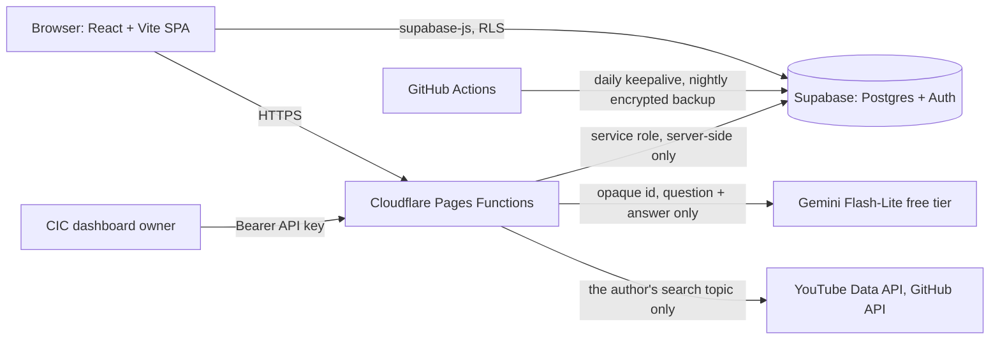

# Architecture

How the system fits together. The current, reconciled design, with the status of every
workflow, is [design/system-design-v3.md](design/system-design-v3.md); this file is the shorter
tour of the pieces. Most of it is built (the README lists what is and is not). Why each piece was
chosen is in [decisions](decisions.md); what it costs us is in [tradeoffs](tradeoffs.md); how to
run and extend it is in the "Stack, commands and layout" section of [AGENTS.md](../AGENTS.md).

## Overview



- **Frontend:** React, TypeScript, Vite SPA, React Router, Tailwind and shadcn/ui
  (Radix), TanStack Query, react-hook-form, zod, Recharts, Papa Parse. Static
  files on Cloudflare Pages.
- **Data and auth:** Supabase Postgres with row-level security on every table.
  Supabase Auth: anonymous session plus login-code claim for students, Google
  sign-in for staff, reviewers and mentors.
- **Core logic in Postgres functions:** grading, unlock, login-code claim, next
  activity. They run next to the data and cannot be skipped by the browser.
- **HTTP endpoints:** Cloudflare Pages Functions for the read API, the AI hint
  proxy and Find material (YouTube and GitHub search for authors). Secrets live in
  Cloudflare env vars, never in the browser or git.
- **Ops:** GitHub Actions for lint, type check, tests, Lighthouse CI, gitleaks,
  the daily keepalive ping and the nightly encrypted backup.

## Content model

`module → lesson → activity`. Every student action becomes a row we can aggregate.

Core tables: `profiles`, `schools`, `classes` (`kind` is school or open; one
"CIC Open" class holds every independent student), `class_members`, `concepts`,
`modules`, `lessons`, `activities`, `activity_keys`, `assessments`,
`assessment_items`, `class_modules`, `submissions` (append-only), `progress`,
`assessment_results`, `api_keys`, plus `mentors`, `mentor_assignments`,
`mentor_notes`, `hint_cache`, `hint_events`.

Server-side functions: `submit_answer`, `claim_login_code`, `next_activity`,
`self_register`, `import_guest_progress`. `self_register` sits behind a Pages
Function that rate-limits by IP to block spam sign-ups.

Views read by both the dashboard and the read API, so numbers always agree:
`v_class_progress`, `v_stuck`, `v_learning_gain`, `v_concept_mastery`.

The authoritative schema is the SQL in `supabase/migrations/`. If this file and the SQL differ,
the SQL is right. The calls the app can make are listed in
[contracts/database-api.md](contracts/database-api.md), and the design reasons are in
[ADR 0024](adr/0024-lane-a-database-design.md).

## Roles

Six roles, one `role` column on `profiles`: student, independent student
(homeschool), mentor (approved volunteer), instructor, CIC admin, reviewer
(read-only). The full capability matrix is in the team plan; in short:

- Browsing published lessons needs no account; guest progress stays on the device
  until the learner self-registers. CIC's camps use locked-down lab machines with
  no student accounts, so this no-login path is a real requirement. If those
  machines clear browser storage between sessions, guest progress is lost (unconfirmed).
- Instructors and CIC staff draft modules; only CIC admin publishes. Publishing
  creates an immutable version; a class stays on the version it started with.
- Only CIC admin manages API keys, invites reviewers and approves mentors.

Mentor safeguards (volunteers working with minors): Google sign-in, CIC admin
approval before seeing any student, access only to assigned mentees through
`is_mentor_of(student_id)`, all contact on-platform, mentor notes logged and
visible to CIC admin, and outbound notes are drafted by the system and sent by a human.

## Security boundaries

- Default deny. One `role` column on `profiles`; policies keyed on class membership
  through helpers `is_admin()`, `is_instructor_of()`, `is_member_of()`,
  `is_mentor_of()`.
- **Answer keys** live in `activity_keys`; no student or reviewer policy can read
  them. Only security-definer functions do. The client gets correct/incorrect
  plus feedback.
- **Reviewer** has no write policy anywhere, sees published curriculum with
  answer keys hidden, and sees no student data.
- **Read API:** one key per consumer, stored hashed, aggregated rows only,
  groups under 5 students suppressed.
- **AI:** receives only the item text and the student's answer under an opaque
  id. No names or school. Capped at 3 hints per activity. Falls back to
  instructor-written hints on any failure.
- **Find material** (`/api/sources/search`, `/api/sources/readme`): authors only,
  checked with the caller's own token against `is_author()`; no service role. Only
  the typed topic leaves the site. Videos are strict SafeSearch, embeddable only, and
  embedded through youtube-nocookie. README text is copied only from repositories
  under an open license (checked again on import), with images, badges and HTML
  removed and the source and license on the first line. Results are cached by query
  for a day, never by person. Everything added lands in a draft that a CIC admin
  reviews before students see it.

## Unlock and "stuck" defaults

- Strict order: activities in a lesson, lessons in a module, modules in a class.
  A module opens after its pretest is taken (not passed). Instructor can
  override for one student.
- **Stuck:** three wrong attempts on one activity, or an activity open over 10
  minutes without completion, or no activity for 3 school days on an assigned
  module. *Default, unconfirmed with CIC.*
- **Not started:** enrolled student with zero progress rows on the assigned module.
- **Late joiner:** lands on the first incomplete activity of the earliest open module.
- **Learning gain:** post minus pre in points, plus normalized gain
  `(post − pre) / (100 − pre)`; per student, class and concept.

## Lanes and ownership

| Lane | Owner | Owns |
|---|---|---|
| A | Koen | Schema, RLS, key isolation, views, seed. Koen wrote the first drafts; Umang consolidated them into the current migrations, functions and tests (PR #11) and added `get_me` and class staffing |
| B | Daxx | Student player, unlock UX, late-joiner card, mobile |
| C | Umang | Authoring studio, test builder, learning gain logic. Also built sign-in, the instructor class setup, parts of the admin console and the reviewer view |
| D | Jad | Roster import, instructor dashboard, admin console, stuck lists |
| E | Krishna | Read API and its docs, hints function (not built yet), deploy, CI, `docs/` |

## Extending the system

The structure is built so new work is added, not threaded through shared code. The
step-by-step recipes are in [AGENTS.md](../AGENTS.md); the design is:

- **Features are folders.** Each `src/features/<name>/` exports a `FeatureModule`
  (`src/lib/feature.ts`: id, nav label, path, routes). `src/app/features.ts` lists
  them, and the router and nav bar are built from that list. Adding a feature is a new
  folder plus one line; no change to the router or layout. A test fails if ids or
  paths clash. Features never import each other; shared code lives in `src/lib/`,
  `src/components/` or `shared/`.
- **Endpoints are files.** `functions/api/<name>.ts` is served at `/api/<name>`;
  helpers live in `functions/_lib/`, and `functions/` is type-checked on its own
  against the Workers runtime.
- **One contract for both sides.** `shared/` holds what the browser and the functions
  must agree on: the six roles now, zod schemas as forms and endpoints are added.
- **The database has its own home.** `supabase/` holds migrations, RLS, seed and the
  per-role tests, so lane A works without touching app code.
- **Ownership follows folders**, one lane per folder (table in AGENTS.md).

## Assumptions that are ours, not in the team plan

Lane E's reading of the plan. Confirm with Koen (lane A) and fix here if wrong.

- The Pages Function for the read API uses the Supabase **service role** key,
  which bypasses RLS. So the function itself must enforce aggregation and the
  under-5 suppression, preferably by reading dedicated `api_*` views, and must
  never return per-student rows.
- Callers send the key as `Authorization: Bearer <key>`; the server stores only
  a hash and compares in constant time.
- Pages Functions are a Cloudflare product that Cloudflare has been steering
  toward Workers; check current status before relying on it.
- **Slides.** CIC's curriculum is mostly slides, but the planned activity kinds are
  video, reading, check, worksheet and exit. Proposal: add a `slides` kind (an embed of
  Google Slides or Docs, with a link fallback). Needs agreement from Koen (schema)
  and Umang (authoring).
- **Read API shape.** Flat JSON (and optional CSV) under `/api/v1/`, with an "as of"
  timestamp, cohort/class/concept breakdowns and `from`/`to` filters, key in a header.
  The aggregation lives in dedicated `api_*` views. Details and reasons are in
  [requirements](requirements.md#read-api-what-the-brief-says-and-what-we-propose);
  the dashboard's real needs are still unknown.
- A second consumer is possible (the brief's Problem 2 funder packet pulling outcomes),
  so the API should be usable by code other than CIC's dashboard.

## Repo layout

```
docs/                   requirements, architecture, decisions (adr/), tradeoffs, audits, progress, deploy
docs/design/            the team design (system-design-v3.md is current; system-design.md is the first plan)
docs/contracts/         database-api.md: every function and view the app calls
docs/openapi.yaml       the read API contract (a copy is served at /api/docs)
src/app/                app shell: router, role-aware layout, home page, the feature list (features.ts)
src/features/<name>/    one folder per feature, mapped to the lanes:
  auth/                 sign-in, class join link
  player/               student player (lane B)
  authoring/            authoring studio (lane C)
  instructor/ admin/    class setup and dashboard; admin console (lane D, with additions)
  reviewer/             read-only curriculum view
src/components/         shared UI (shadcn/ui in ui/), learning/ (student-view pieces used by the
                        player, the studio preview and the reviewer view), Dialog, QueryStatus
src/lib/                shared helpers: feature contract, Supabase client, session (who is signed in)
shared/                 code used by both browser and functions: roles, class and login-code rules,
                        authoring/ (zod schemas, learning gain, CSV), api/ (read API handlers and types),
                        hint/ (the hint handler), sources/ (Find material: catalog, YouTube, GitHub, handler)
functions/api/          Pages Functions, one file per endpoint (health, hint, sources/search,
                        sources/readme, v1/completion, v1/learning-gain)
functions/_lib/         helpers for the functions (env bindings, dependencies, the search cache)
public/api/docs/        the static API reference page served at /api/docs
supabase/               migrations, seed, config and the per-role tests (layout in its README)
lane-d-logic/           Jad's early stuck-student and roster logic, kept for reference
.github/workflows/      ci.yml (lint, types, tests, build, gitleaks), db-tests.yml, pr-lint.yml
```
