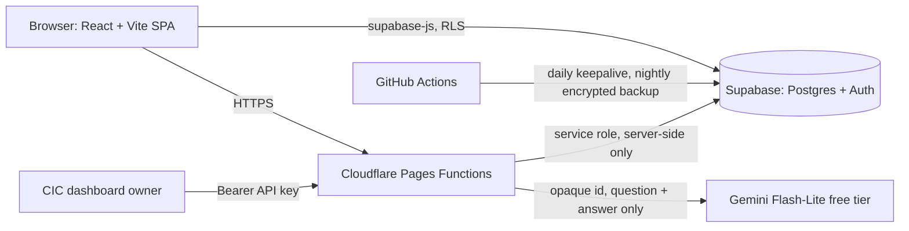

# Architecture

How the system fits together. Status: **design**. Nothing here is built yet;
update this file as the code lands so it stays true. Why each piece was chosen
is in [decisions](decisions.md); what it costs us is in [tradeoffs](tradeoffs.md).

## Overview



- **Frontend:** React, TypeScript, Vite SPA, React Router, Tailwind and shadcn/ui
  (Radix), TanStack Query, react-hook-form, zod, Recharts, Papa Parse. Static
  files on Cloudflare Pages.
- **Data and auth:** Supabase Postgres with row-level security on every table.
  Supabase Auth: anonymous session plus login-code claim for students, Google
  sign-in for staff, reviewers and mentors.
- **Core logic in Postgres functions:** grading, unlock, login-code claim, next
  activity. They run next to the data and cannot be skipped by the browser.
- **HTTP endpoints:** Cloudflare Pages Functions for the read API and the AI hint
  proxy. Secrets live in Cloudflare env vars, never in the browser or git.
- **Ops:** GitHub Actions for lint, type check, tests, Lighthouse CI, gitleaks,
  the daily keepalive ping and the nightly encrypted backup.

## Content model

`module → lesson → activity`. Every student action becomes a row we can aggregate.

Core tables: `profiles`, `schools`, `classes` (`kind` is school or open; one
"CIC Open" class holds every independent student), `class_members`, `concepts`,
`modules`, `lessons`, `activities`, `activity_keys`, `assessments`,
`assessment_items`, `class_modules`, `submissions` (append-only), `progress`,
`assessment_results`, `api_keys`, plus `mentors`, `mentor_assignments`,
`mentor_notes`, `hint_cache`, `hint_events`.

Server-side functions: `submit_answer`, `claim_login_code`, `next_activity`,
`self_register`, `import_guest_progress`. `self_register` sits behind a Pages
Function that rate-limits by IP to block spam sign-ups.

Views read by both the dashboard and the read API, so numbers always agree:
`v_class_progress`, `v_stuck`, `v_learning_gain`, `v_concept_mastery`.

The authoritative schema is the SQL in `supabase/` (lane A, Koen). If this
file and the SQL differ, the SQL is right.

## Roles

Six roles, one `role` column on `profiles`: student, independent student
(homeschool), mentor (approved volunteer), instructor, CIC admin, reviewer
(read-only). The full capability matrix is in the team plan; in short:

- Browsing published lessons needs no account; guest progress stays on the device
  until the learner self-registers.
- Instructors and CIC staff draft modules; only CIC admin publishes. Publishing
  creates an immutable version; a class stays on the version it started with.
- Only CIC admin manages API keys, invites reviewers and approves mentors.

Mentor safeguards (volunteers working with minors): Google sign-in, CIC admin
approval before seeing any student, access only to assigned mentees through
`is_mentor_of(student_id)`, all contact on-platform, mentor notes logged and
visible to CIC admin, and outbound notes are drafted by the system and sent by a human.

## Security boundaries

- Default deny. One `role` column on `profiles`; policies keyed on class membership
  through helpers `is_admin()`, `is_instructor_of()`, `is_member_of()`,
  `is_mentor_of()`.
- **Answer keys** live in `activity_keys`; no student or reviewer policy can read
  them. Only security-definer functions do. The client gets correct/incorrect
  plus feedback.
- **Reviewer** has no write policy anywhere, sees published curriculum with
  answer keys hidden, and sees no student data.
- **Read API:** one key per consumer, stored hashed, aggregated rows only,
  groups under 5 students suppressed.
- **AI:** receives only the item text and the student's answer under an opaque
  id. No names or school. Capped at 3 hints per activity. Falls back to
  instructor-written hints on any failure.

## Unlock and "stuck" defaults

- Strict order: activities in a lesson, lessons in a module, modules in a class.
  A module opens after its pretest is taken (not passed). Instructor can
  override for one student.
- **Stuck:** three wrong attempts on one activity, or an activity open over 10
  minutes without completion, or no activity for 3 school days on an assigned
  module. *Default, unconfirmed with CIC.*
- **Not started:** enrolled student with zero progress rows on the assigned module.
- **Late joiner:** lands on the first incomplete activity of the earliest open module.
- **Learning gain:** post minus pre in points, plus normalized gain
  `(post − pre) / (100 − pre)`; per student, class and concept.

## Lanes and ownership

| Lane | Owner | Owns |
|---|---|---|
| A | Koen | Schema, RLS, `submit_answer`, key isolation, views, seed |
| B | Daxx | Student player, unlock UX, late-joiner card, mobile |
| C | Umang | Authoring studio, test builder, learning gain screens |
| D | Jad | Roster import, instructor dashboard, admin console, stuck lists |
| E | Krishna | Read API and docs, reviewer view, hints function, deploy, README |

## Assumptions that are ours, not in the team plan

Lane E's reading of the plan. Confirm with Koen (lane A) and fix here if wrong.

- The Pages Function for the read API uses the Supabase **service role** key,
  which bypasses RLS. So the function itself must enforce aggregation and the
  under-5 suppression, preferably by reading dedicated `api_*` views, and must
  never return per-student rows.
- Callers send the key as `Authorization: Bearer <key>`; the server stores only
  a hash and compares in constant time.
- Pages Functions are a Cloudflare product that Cloudflare has been steering
  toward Workers; check current status before relying on it.

## Repo layout (planned; update as it is created)

```
docs/            requirements, architecture, decisions, tradeoffs, audits, progress
supabase/        migrations, RLS policies, functions, seed (lane A)
functions/api/   Cloudflare Pages Functions: read API, hint proxy (lane E)
src/             React app
```
