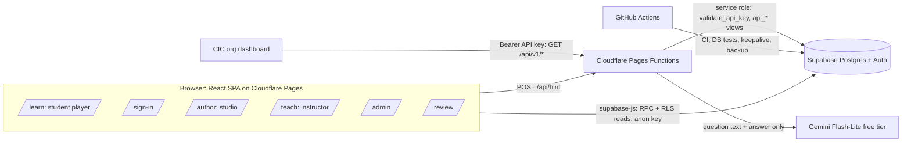

# CIC Problem 1: System Design v3 (reconciled against `main`)

As of Sat Nov 14, 2026, 4:45 PM MST. Source of truth: `main` at `465e3d2` (PR #14).
This file replaces three conflicting documents:

| Document | Where it lives | Status after v3 |
|---|---|---|
| Design Plan v1 (Supabase, Cloudflare, React) | `docs/design/system-design.md`, team Google doc | Superseded. Keep as history |
| SYSTEM_DESIGN v2 (Neon, Vercel, plain HTML + Alpine, dynamic roles) | Claude project, Slack | Superseded. Its stack is dropped (D1). Good ideas moved to the Parking lot (section 8) |
| `docs/architecture.md` | repo | Mostly right, but says "nothing is built yet". Update it to point here |

**How status is marked in this file**

- **BUILT**: on `main` and verified (tests, or I ran it against a real Postgres).
- **PARTIAL**: some pieces exist, but the workflow can't run end to end yet.
- **MISSING**: not on `main`.
- **PARKED**: a good idea we agreed to hold until the core system works end to end.

**One line:** a teacher shares a link, the platform teaches, the instructor manages. Students
work through modules (video, check, worksheet, exit question). The next step unlocks only
after the current one is done. CIC gets learning gain per student, class and concept without
a spreadsheet.

---

## 1. Where we are in one paragraph

The **database is the most complete part**. It has 26 tables with RLS, the unlock engine, grading,
codes, publishing, views and the read API views, and I ran a full student journey on it
successfully. The **student player** is complete but has only ever run against mock data.
The **read API** works. The remaining gap is the glue: **nobody can sign in** (the sign-in page is
a placeholder and no code calls Supabase Auth). The instructor dashboard shows hard-coded demo
students. The authoring studio, admin console and reviewer view are placeholders. Nothing is
deployed. Overall: about **45% of P0**. The backend is about 85%, the frontend about 35%,
and deploy and docs about 30%.

---

## 2. Decisions

**Locked on Sat Nov 14 (D1 to D3).** The rest are defaults (already what `main` does) until the team says otherwise.

| # | Question | v1 said | v2 said | `main` does | Decision |
|---|---|---|---|---|---|
| D1 | Stack | Supabase + Cloudflare Pages + React | Neon + Vercel + plain HTML/Alpine | Supabase + Cloudflare Pages + React/TS/Vite | **LOCKED: Supabase + Cloudflare Pages + React (`main`).** v2's stack is dropped |
| D2 | Roles | 6 fixed roles | Roles and permissions as editable tables (`has_permission`) | 6 fixed roles in a CHECK constraint, plus `can_author`. Admin can change anyone's role | **LOCKED: fixed roles.** Dynamic roles parked |
| D3 | Student login | Personal code + join link | Class code + name + 4-digit PIN, cookie | Personal 16-character code (shown once at roster import), or join code + pick your unclaimed name, both on an anonymous Supabase session | **LOCKED: `main`'s codes + a printable sheet with QR codes.** PIN parked |
| D4 | Duplicate names on a roster | not covered | PIN tells them apart | `import_roster` rejects the whole import on a duplicate | **Ask the instructor to add a last initial** (the preview says so). Revisit with PIN |
| D5 | Late joiner | Auto "start here" | Instructor picks the start module | Auto: `next_activity` | **Auto.** Instructor placement parked |
| D6 | Instructor unlocks ahead for one student | Yes | Yes, logged with a reason | Not built | **Parked** (P1) |
| D7 | Slides as an activity kind | no | no | 5 kinds. `architecture.md` proposes `slides` | **Parked.** Use a reading with a link to the slides for now |
| D8 | Hosting | Cloudflare Pages | Vercel | Cloudflare Pages Functions in `functions/` | **Cloudflare Pages.** Someone has to get org repo access today |
| D9 | Who owns sign-in (M1) | Lane A | n/a | Lane B removed its login pages, saying "auth feature owns sign-in". Nobody has built it | **Needs an owner now** (biggest blocker) |

---

## 3. Final stack (what `main` actually uses)

| Layer | Choice | Status |
|---|---|---|
| Frontend | React 19, TypeScript, Vite 8, Tailwind 4, shadcn/ui on Radix, TanStack Query, react-hook-form, zod, react-markdown. One folder per feature in `src/features/`, registered in `src/app/features.ts` | BUILT (shell, player, instructor pieces) |
| Database | Supabase Postgres, 5 migrations in `supabase/migrations/`, `supabase/seed.sql` | BUILT |
| Auth | Supabase Auth. Students: an anonymous session claims a roster seat with a code. Staff: Google sign-in matched to an admin invite. Email sign-in turned off | BUILT in the DB, MISSING in the UI |
| Business logic | Postgres security-definer functions (RPC through supabase-js). Clients read through RLS and write only through functions | BUILT |
| HTTP endpoints | Cloudflare Pages Functions in `functions/api/` | PARTIAL: `/api/health`, `/api/v1/completion`, `/api/v1/learning-gain` built. `/api/hint` and `/api/self-register` MISSING |
| Shared contracts | `shared/authoring/schemas.ts` (zod content + keys), `shared/authoring/gain.ts`, `shared/api/*` | BUILT |
| AI | Instructor-written hint ladder (in the answer keys) served by `submit_answer`. Gemini Flash-Lite through `/api/hint` | Ladder BUILT, Gemini MISSING |
| Analytics | SQL views, rule-based. **No ML**, on purpose (mentor guidance: rule-based flags) | BUILT in the DB |
| CI | GitHub Actions: lint (oxlint), typecheck, Vitest, build, gitleaks; a separate DB job runs 35 per-role tests on local Supabase | BUILT. Lighthouse CI, keepalive and backup MISSING |
| Hosting | Cloudflare Pages + hosted Supabase free tier, $0, no card | MISSING (not deployed) |

---

## 4. Architecture

Rules that hold everywhere:

- The browser holds only the public anon key. What a user sees is decided by RLS in the database.
- Every write is a database function that checks `auth.uid()` and the role. There are four direct
  writes: your own display name, a class's name and term, schools (admin), and appending a mentor note.
- Answer keys, login codes, join codes and API key hashes live in tables with no client policy.
  CHECK constraints refuse any content that contains a key field.
- The service-role key exists only in Cloudflare env vars, and only for the read API and hints.

---

## 5. Every workflow from start to end

Each step lists what happens, where it lives, and its status.

### W1. One-time setup (CIC admin, by the README)
1. Create the Supabase project, push the migrations, turn on Google and Anonymous sign-in, turn off Email. Status: documented in `supabase/README.md`.
2. Sign in once with Google, then promote yourself in SQL: `update profiles set role='cic_admin'`. Status: BUILT (manual by design).
3. Create the "CIC Open" class and the schools. Status: SQL only. No UI for schools (`schools` has an admin insert policy, so a small form is enough).

### W2. Staff sign-in (instructor, author, mentor, reviewer, admin)
1. The admin invites an email with a role (`invite_staff`). Status: DB BUILT, UI MISSING (admin console).
2. The person clicks "Sign in with Google". `handle_new_auth_user` gives them the invited role if the verified Google email matches. Status: DB BUILT and verified. **UI MISSING: no `signInWithOAuth` anywhere in `src/`.**
3. After sign-in they land on the page for their role. Status: MISSING. The nav shows every feature to everyone.

### W3. Author a module (instructor with `can_author`, or admin)
1. The studio form builds module → lessons → activities (video, reading, check, worksheet, exit) and questions (mcq, short answer, fill in the blank, ordering, reflection), plus hints, a pre-test and a post-test paired by `pair_key`. zod schemas: BUILT (`shared/authoring/schemas.ts`, 52 tests). **Studio UI MISSING** (`/author` is "Coming soon").
2. Save the draft with `save_module_draft`, which validates and splits keys from content. Status: DB BUILT.
3. Submit it with `submit_module`, which returns errors and warnings. Then the admin publishes with `publish_module`, which freezes the version. `new_module_version` makes an editable copy. Status: DB BUILT.

### W4. Class setup and codes (instructor or admin)
1. Create a class with `create_class` (an instructor can only create one at a school that already exists; the creator becomes its instructor). Status: DB BUILT, **UI MISSING**.
2. Import the roster CSV. The preview shows row errors, and only names are kept. `import_roster` returns one personal login code per student, **shown once**. Status: BUILT (`RosterImport.tsx`, PR #14). Missing: a printable sheet with QR codes.
3. Make a class join code with `create_join_code` (for late joiners and lost codes). Status: DB BUILT, **UI MISSING**.
4. Assign a published module with `assign_module`. A class stays on that version. Status: DB BUILT, **UI MISSING**.
5. Reset a lost code with `reset_login_code`. Data follows the student to the new device. Status: DB BUILT, UI MISSING.

### W5. Student sign-in (no email, no password)
1. **Personal code:** open the link, type the code. The app starts an anonymous session (`signInAnonymously`), then calls `claim_login_code`. The device stays signed in. Status: DB BUILT and verified. **UI MISSING** (lane B removed its pages in `18d4343`, and the sign-in feature is a placeholder).
2. **Join link:** `/join/<code>` lists unclaimed names (`list_join_roster`), and the student picks theirs (`claim_roster_seat`). Status: DB BUILT, **UI MISSING**.
3. **Guest:** browse CIC Open lessons with no account. Progress is kept on the device. Status: BUILT (`ExplorePage`, `GuestActivityPage`).
4. **Independent sign-up:** display name only, joins CIC Open, gets a code, and guest progress is merged (`self_register`, `import_guest_progress`). Status: DB BUILT. **The UI posts to `/api/self-register`, which does not exist.** Fix: call the RPC directly after the anonymous sign-in.

### W6. Student learns a module
1. "Start here" card. Status: PARTIAL. **Bug:** `next_activity` returns `null` when the next step is the pre-test or post-test, and `LearnHomePage` shows "You've finished everything" for a brand-new student. I reproduced this on the real DB. The mock never hits it because it ignores the pre-test gate.
2. Take the pre-test with `get_assessment` and `submit_assessment`. It is one shot, and a student can retake only after an instructor reset. Status: BUILT.
3. Work through the activities in strict order. `get_activity` refuses locked ones server-side. Video and reading send `viewed`. A check completes only when all answers are right; each wrong try returns the next hint on the ladder. A worksheet or exit completes on a full submission and records the score. Status: BUILT. I verified 7 activities in order and that a locked activity is refused.
4. The post-test opens when the required activities are done. The next module unlocks after the post-test. Status: BUILT and verified.
5. A heartbeat every 15 to 60 seconds records time on task (feeds "stuck"). Status: BUILT.
6. A "Get a hint" button for AI hints after a wrong answer. Status: UI BUILT behind `VITE_FEATURE_HINTS=false`, endpoint MISSING.

### W7. Student dashboard
1. My progress: completed out of total, per-module percent, pre, post and gain (`get_my_progress`, `ProgressPage`). Status: BUILT. Small fix: round the numbers (the DB returns long decimals).
2. My classes and my path through the module (`get_my_classes`, `get_class_outline`, `ClassPathPage`). Status: BUILT.
3. Blocked by W5 and by `get_me`: `LearnLayout` calls the RPC `get_me`, **which does not exist in the DB**. In Supabase mode every `/learn` page errors until the RPC is added (lane A) or `getMe` is rewritten to use `get_my_classes`.

### W8. Instructor dashboard
1. Pick a class (classes the instructor teaches, through RLS). Status: PARTIAL (used only by roster import).
2. Roster with per-student completion (`v_class_progress`), a not-started list (`v_not_started`) and a stuck list (`v_stuck`: 3 wrong tries, over 10 minutes, or 3 school days idle). Status: DB BUILT and verified. **UI shows hard-coded demo students** (`dashboardData.ts`).
3. Learning gain per student, class and concept (`v_learning_gain`, ADR 0020), CSV export (`shared/authoring/csv.ts`). Status: DB BUILT. UI computes from demo data.
4. "Reteach tomorrow": concepts ranked by wrong rate and hints (`v_reteach`), and concept mastery (`v_concept_mastery`). Status: DB BUILT, UI shows the demo "weakest concept".
5. Reset a code, reset a test, and see the join code. Status: DB BUILT, UI MISSING.

### W9. Admin console
1. Invite staff, change roles, toggle `can_author` (`invite_staff`, `set_profile_role`). Status: DB BUILT, UI MISSING.
2. Assign mentors (`assign_mentor`). Status: DB BUILT, UI MISSING.
3. API keys: create (raw key shown once) and revoke (`create_api_key`, `revoke_api_key`). Status: DB BUILT, UI MISSING.
4. All classes and cohorts, completion and gain (the admin sees everything through the same views). Status: DB BUILT, UI MISSING.
5. Publish submitted modules (W3.3). Status: DB BUILT, UI MISSING.

### W10. Reviewer (district or K-12 teacher, read-only)
1. Google sign-in after an admin invite as `reviewer`. Status: same as W2.
2. Browse published modules, with no answer keys and no student data. Status: DB BUILT and verified (sees 1 module, 0 progress rows, a key request is refused). **UI MISSING.**

### W11. Mentor (volunteer)
1. Invited as `mentor`, assigned to students by the admin. Sees only those students' progress and gain, writes notes that are logged. Status: DB BUILT, UI MISSING. PARKED for the demo unless time allows.

### W12. Read API for CIC's org dashboard
1. `GET /api/v1/completion` and `GET /api/v1/learning-gain` with `Authorization: Bearer <key>`. Returns 401 with no key or a bad key, 403 for the wrong scope, and aggregates only. Groups under 5 students are dropped, and CSV is optional. Status: BUILT (`shared/api/handler.ts` + tests, `docs/openapi.yaml`). Verified the views return 2 classes. Missing: a rendered docs page at `/api/docs`.

### W13. AI
1. Hint ladder first (no AI): BUILT.
2. Gemini call: the Pages Function checks `hint_cache`, sends only the prompt and the student's answer, rejects output containing the key, logs to `hint_events`, caps at 3 per activity, and falls back to the ladder. Status: MISSING. The DB side (tables, service-role access) is ready.
3. Instructor "stuck now" summary and nudge draft (a human sends it). Status: MISSING, P1.

### W14. Analytics (no ML)
All analytics are SQL views, so the dashboard and the read API always show the same numbers:
`v_class_progress`, `v_not_started`, `v_stuck`, `v_concept_mastery`, `v_reteach`, `v_learning_gain`,
`api_class_progress`, `api_class_gain`. Rule-based by design. ML (for example predicting who
will get stuck) is parked: we have no real data to train on, and the mentors asked for rule-based flags.

### W15. Ops and docs
| Item | Status |
|---|---|
| CI: lint, typecheck, 188 tests, build, gitleaks | BUILT, green locally |
| DB tests (35) in `db-tests.yml` | BUILT. Skipped locally (no Docker). I verified the migrations and seed separately on Postgres 16 |
| Cloudflare Pages deploy + hosted Supabase | MISSING |
| Keepalive ping, nightly encrypted backup | MISSING (P1) |
| README: team, what we built, live link, demo login per role | MISSING (template text) |
| SECURITY.md | MISSING |
| ADRs 0020 to 0024, `docs/contracts/database-api.md`, `docs/openapi.yaml` | BUILT |
| Admin how-to with screenshots, pitch video | MISSING (Sunday morning) |

---

## 6. Flags (everything I found)

### Critical: the demo breaks without these
| # | Flag | Evidence | Fix | Lane |
|---|---|---|---|---|
| C1 | No sign-in at all, for students or staff | `/sign-in` is ComingSoon. No `signInAnonymously`, `signInWithOAuth`, `claim_login_code` or `claim_roster_seat` call in `src/` | Build `/sign-in` (code entry + Google button), `/join/:code`, and a role redirect | Owner needed (D9) |
| C2 | `get_me` RPC missing | `LearnLayout` → `useMe` → `rpc('get_me')`. `function public.get_me() does not exist` on the real DB | Add `get_me()` to the DB: `{role, display_name, class_id, class_name}` | A |
| C3 | New student sees "You've finished everything" | `next_activity` returns null before the pre-test (contract + reproduced). `LearnHomePage` treats null as finished. The mock disagrees with the DB | Return `{kind:'assessment', assessment_id}` from `next_activity`, or have the UI check the outline for an available pre/post test. Make the mock match the DB | A + B |
| C4 | Self-register calls a missing endpoint | `postFunction('/api/self-register')`, with no such file in `functions/api/` | Call the `self_register` RPC after the anonymous sign-in | B |
| C5 | Instructor dashboard is fake | `dashboardData.ts`: "Fictional demo data only" | Read `v_class_progress`, `v_stuck`, `v_not_started`, `v_learning_gain`, `v_reteach` for the chosen class | D |
| C6 | Instructors can't create a class, make a join code, or assign a module in the UI | Only roster import exists | Small forms calling `create_class`, `create_join_code`, `assign_module` | D |
| C7 | Demo classes have no instructor, and there's no way to add one | Seed classes have no instructor rows. A signed-in instructor saw 0 classes. No RPC adds an instructor to an existing class | Add `add_class_instructor(class_id, profile_id)` (admin) and use it in the demo setup script | A |
| C8 | Authoring studio not built | `/author` placeholder | Minimal form → `save_module_draft` → `submit_module` | C |
| C9 | Admin console not built | `/admin` placeholder | Invite staff, publish, API keys first | D (or E) |
| C10 | Nothing deployed | No live link, Cloudflare access unconfirmed | Hosted Supabase + Pages today, with `VITE_DATA_SOURCE=supabase` | E |
| C11 | Role name mismatch: the app says `admin`, the DB says `cic_admin` | `shared/roles.ts` vs the `profiles.role` CHECK constraint | Change `shared/roles.ts` to `cic_admin` (the DB is the source of truth) | B or E |
| C12 | A whole classroom can't sign in at once | `supabase/config.toml`: `anonymous_users = 30` per hour **per IP**. A school puts 30+ Chromebooks behind one IP | Raise the anonymous sign-in limit in the hosted project (Auth > Rate Limits) to about 500, and in `config.toml` | E |
| C13 | Google sign-in redirect won't match locally | `config.toml` `site_url` is port 3000, Vite serves on 5173 | Set `site_url` and `additional_redirect_urls` to the Vite and Pages URLs | E |

### Documents vs `main` mismatches
| # | Mismatch | Resolution |
|---|---|---|
| M1 | Stack: v2 says Neon/Vercel/HTML, `main` is Supabase/Cloudflare/React | Resolved: `main` (D1) |
| M2 | Roles: v2 dynamic RBAC tables vs fixed roles | Resolved: fixed (D2) |
| M3 | Student login: v2 code + name + PIN vs personal code / join-link name pick | Resolved: `main` + QR (D3) |
| M4 | Duplicate names: v2 PIN vs `import_roster` rejecting them | D4 |
| M5 | Late joiner and unlock-ahead: v2 instructor placement + `unlock_overrides` vs auto only | D5, D6 |
| M6 | Events: v2 one `learning_events` table vs `submissions`, `progress`, `assessment_responses`, `hint_events` | Keep `main`. Same data |
| M7 | Versions: v2 `module_versions` snapshot vs one `modules` row per version with freeze triggers | Keep `main` (ADR 0023/0024) |
| M8 | `audit_log` in v2, not in `main` | Parked. Mentor notes are already logged |
| M9 | Activity kinds: v2 adds `code` (Pyodide), architecture proposes `slides` | Parked (D7) |
| M10 | Read API paths: v2 `/cohorts`, `/classes/:id/summary`, `/concepts/mastery` vs `main` `/completion`, `/learning-gain` | Keep `main` (OpenAPI written) |
| M11 | Staff login: v1 module table says magic links, Q9 says Google | Keep Google only, email off |
| M12 | `architecture.md` says "nothing here is built yet", and the lanes table says Koen owns lane A while Umang rebuilt it | Update the doc |
| M13 | Repo layout: v2 `/public`, `/api`, `/db` vs `src/`, `functions/`, `supabase/` | Keep `main` |

### Security notes
| # | Note | Action |
|---|---|---|
| S1 | Anyone with a class join code can claim any **unclaimed** seat (no PIN) | Document in SECURITY.md. The instructor rotates the join code after class. PIN parked |
| S2 | No lockout on login-code guessing (64-bit codes, so guessing isn't practical) | Document |
| S3 | Supabase grants new functions and tables to anon by default. The last migration revokes everything that existed at that point | Every new migration must revoke and grant explicitly (add to `supabase/README.md` rules) |
| S4 | Read API uses the service role. It reads only `api_*` views and `validate_api_key`, with groups under 5 dropped | Good. Keep it that way |
| S5 | `self_register` spam depends on Supabase's anonymous sign-in rate limit | Document. Optional free Turnstile captcha later |

### UX notes
| # | Note | Action |
|---|---|---|
| U1 | Login codes are 16 characters (`XXXX-XXXX-XXXX-XXXX`), hard for a 14-year-old to type | QR + link on the printed sheet (`/sign-in?code=`) |
| U2 | The nav shows Learn, Author, Instructor, Admin and Review to everyone | Role-based nav after sign-in |
| U3 | No CIC branding or palette yet | Polish pass Sunday morning |
| U4 | Progress numbers show long decimals | Round in the UI |

---

## 7. Plan to a working system, end to end

The gate: **a teacher creates a class, imports a roster, and a student signs in with the code
and finishes the seed module on the hosted DB. The instructor sees them on the real dashboard.**

| Order | Work | Lane | Target (MST) |
|---|---|---|---|
| 1 | DB patch: `get_me`, `add_class_instructor`, `next_activity` returns the pending test | A | Sat 7 PM |
| 2 | Sign-in: `/sign-in` code entry, `/join/:code`, Google button, role redirect. Fix self-register and "start here" | B + owner of D9 | Sat 9 PM |
| 3 | Hosted Supabase + Cloudflare Pages live with seed. Bootstrap the admin. Demo instructor attached to Demo Period 1 | E | Sat 9 PM |
| 4 | Instructor: class picker, create class, join code, assign module, printable codes. Dashboard on real views | D | Sat 11 PM |
| 5 | Studio minimum: one module with lessons, activities, questions, keys, hints, pre/post → save, submit | C | Sun 2 AM |
| 6 | Admin minimum: invite staff, publish submitted modules, create and revoke API keys | D or E | Sun 2 AM |
| 7 | Reviewer: read-only browser of published modules | E | Sun 6 AM |
| 8 | README, SECURITY.md, `architecture.md` update, API docs page | E + all | Sun 9 AM |
| 9 | P1 if green: AI hints function, gain chart, CIC palette, a11y and mobile pass | all | Sun 11 AM freeze |
| 10 | Record the video from the frozen build | all | Sun 12 PM |

---

## 8. Parking lot (good ideas, kept, not built until the system works end to end)

| Idea | From | Why parked |
|---|---|---|
| Dynamic roles and a permission grid (`has_permission`) | v2 | Fixed roles + `set_profile_role` covers the demo. Big rewrite of RLS |
| Student PIN, lockout after 5 tries | v2 | Personal codes work now. Revisit with duplicate names |
| Instructor placement of late joiners, unlock ahead with a reason | v2, mentors | Needs `unlock_overrides` in the unlock engine |
| `audit_log` of every admin change | v2 | Nice for Security, not on the demo path |
| `slides` and `code` (Pyodide) activity kinds | architecture.md, v2 | New content shapes in the DB, studio and player |
| Mentor view | v1, v2 | DB ready, UI after P0 |
| AI "stuck now" summary and nudge draft | v1 | After the hints function |
| Bloom level tags | v2 | No consumer yet |
| Worksheet-to-module converter | v1 | Stretch |
| ML for analytics (predict stuck) | team idea | No real data. Mentors asked for rule-based |
| Keepalive ping and nightly encrypted backup | v1 | Needed before CIC uses it, not for judging |
| Lighthouse CI, Playwright e2e | v1, v2 | After the screens exist |

---

## 9. How this was checked

- `main` at `465e3d2`: `npm ci`, lint, typecheck, 188 tests passed (35 DB tests skipped, they need Docker), build passed.
- Applied all 5 migrations + `seed.sql` to Postgres 16 with a stub of Supabase's `auth` schema. All applied cleanly.
- As a new anonymous student: claimed `DEMO-0000-0000-0001`, was blocked from the first activity until the pre-test, took the pre-test, finished all 7 activities in order, took the post-test, and saw gain in `get_my_progress`.
- Security probes: a student reading `activity_keys` was refused, a student saw only their own roster row, and a reviewer saw curriculum but no progress, with the key request refused.
- Staff: an invite became the instructor role on Google sign-in, a duplicate roster name was rejected, and an instructor saw 0 classes they don't teach.
- Read API views returned 2 classes, each with 5 or more students.
- Not checked: CI results on GitHub, and any hosted deployment.
